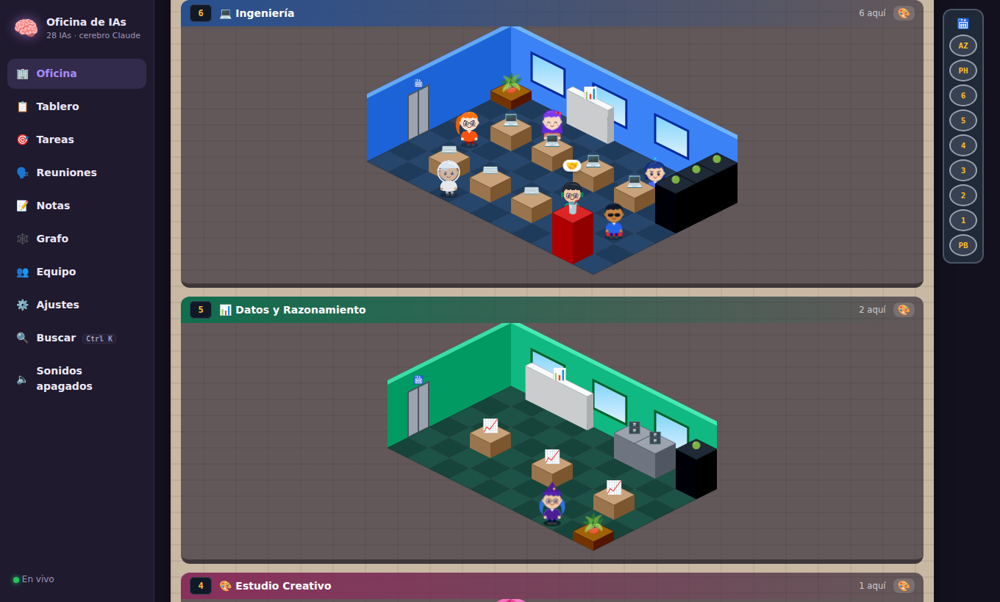
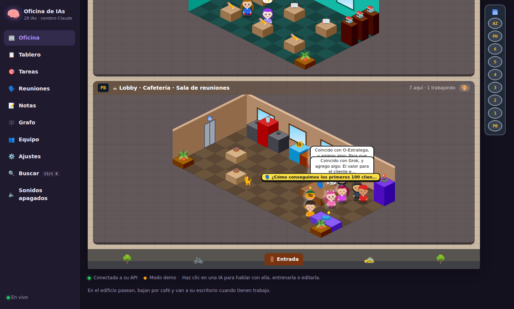
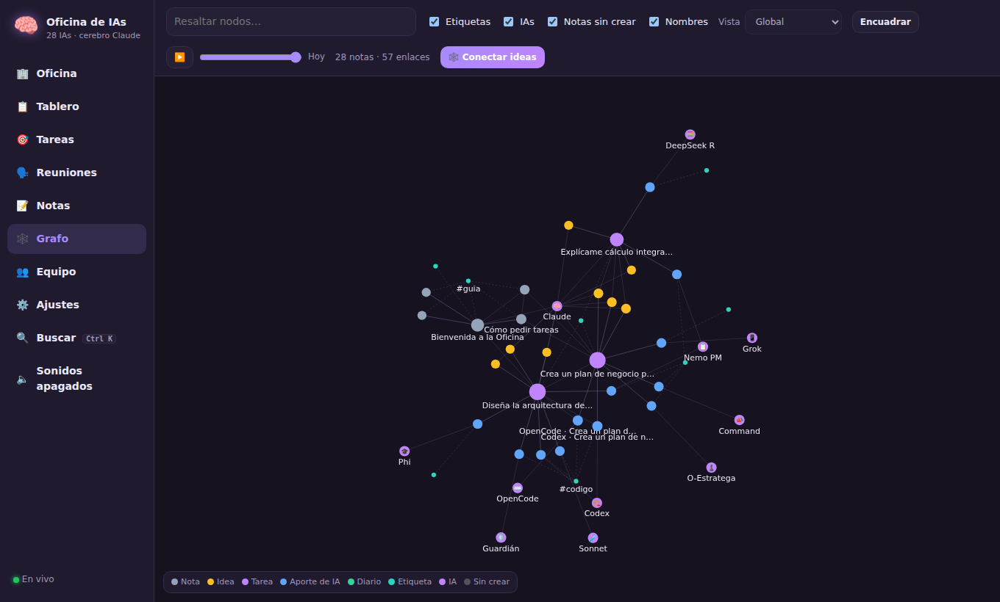
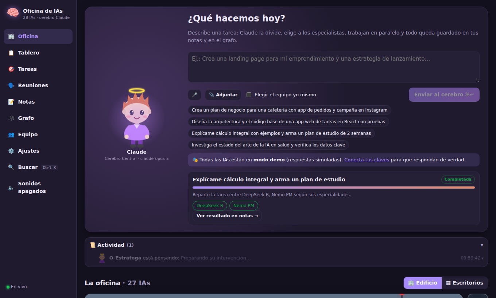
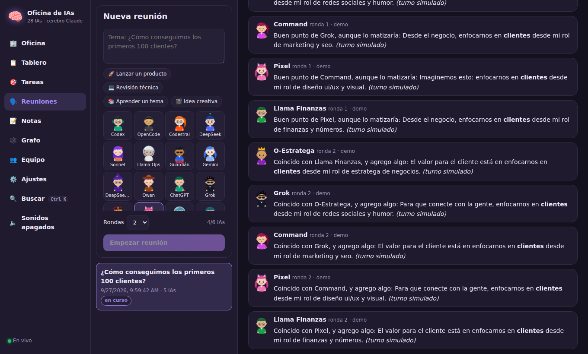
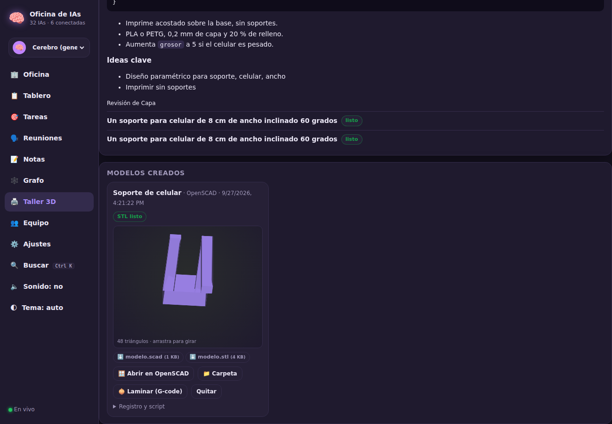
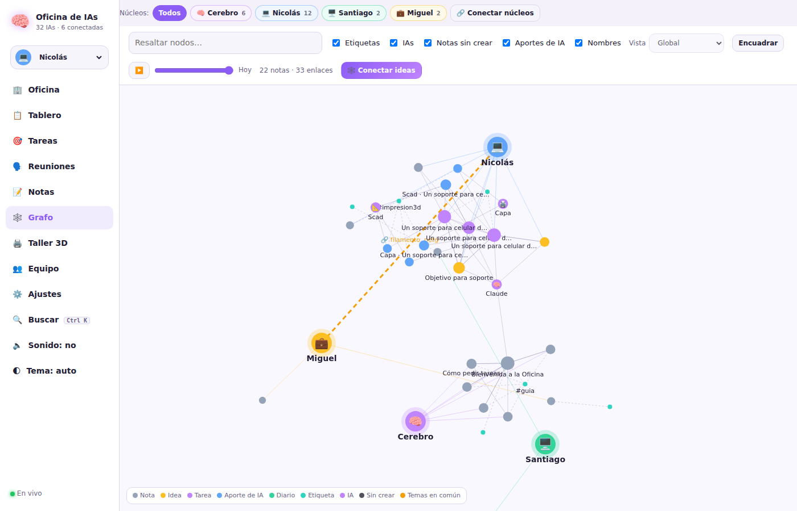
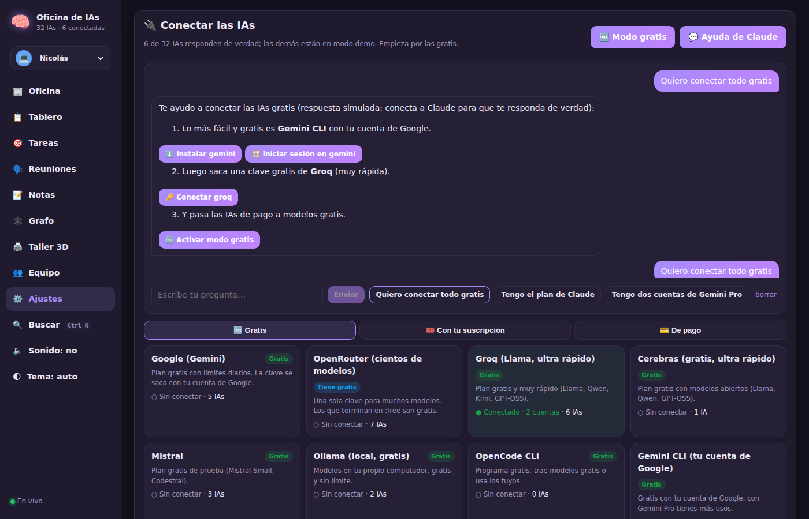

# 🧠 Oficina de IAs

Una oficina virtual donde **Claude es el cerebro central** y coordina a **31 IAs especializadas** (más 16 en el catálogo), la mayoría con **modelos gratis** (ChatGPT, Codex, OpenCode, Gemini, DeepSeek, Grok, Mistral, Perplexity, Llama, Qwen, Kimi y más). Cada IA tiene su **avatar chibi animado**, su escritorio, su memoria y su propio entrenamiento. Todo lo que hace el equipo se guarda como **notas conectadas en un grafo de ideas**, al estilo Obsidian.



| Lobby con reunión en curso | Grafo de ideas |
|---|---|
|  |  |

| Oficina y consola del cerebro | Sala de reuniones |
|---|---|
|  |  |

| Taller 3D con visor del STL | Núcleos del grafo |
|---|---|
|  |  |



## Qué puedes hacer

| Sección | Qué hace |
|---|---|
| 🏢 **Oficina** | Le escribes una tarea a Claude (o se la dictas por voz, con archivos adjuntos o enlaces). Él la divide, elige a los especialistas, los pone a trabajar **en paralelo o en relevos** e integra todo en una respuesta final. Abajo está el **edificio estilo Habbo**: 10 pisos isométricos por donde las IAs caminan, trabajan, se reúnen y descansan. |
| 📋 **Tablero** | Kanban por proyectos (Por hacer, En curso, Hecho). Envía una tarjeta al equipo con un clic; pasa sola a «Hecho» con el enlace al resultado. |
| ⛓️ **Flujos** | Equipos con relevos listos (Crear una app, Lanzar un producto, Contenido para redes, Aprender un tema, Plan de negocio, Analizar datos): cada IA trabaja sobre la entrega de la anterior. |
| 🗣️ **Reuniones** | Eliges varias IAs y un tema: conversan por turnos respondiéndose entre ellas y Claude resume acuerdos y próximos pasos. |
| 🎯 **Tareas** | Historial con el plan del cerebro, el aporte de cada IA (escrito en vivo) y la respuesta integrada. Puedes pedir ajustes para que el mismo equipo continúe, y crear **rutinas automáticas** (por ejemplo, un resumen cada mañana a las 7:00). |
| 📝 **Notas** | Editor Markdown con `[[enlaces]]`, `#etiquetas`, backlinks, casillas `- [ ]` clicables, plantillas, notas fijadas, ideas y diario. Cada tarea genera notas enlazadas automáticamente. Incluye **Resumen del día**, **Trabajar esta nota**, **menciones sin enlazar** y una bóveda compatible con Obsidian (importa archivos o una carpeta completa). |
| 🕸️ **Grafo** | Mapa interactivo de tus ideas: zoom, arrastre, búsqueda, grafo local (1–2 saltos), nodos de IAs, etiquetas, notas por crear y **línea de tiempo**. La bibliotecaria Haiku propone **conexiones entre ideas** relacionadas. Tiene **núcleos** (Cerebro, Nicolás, Santiago, Miguel…): cada persona tiene sus notas, su perfil y se le pueden hacer preguntas; los núcleos que comparten temas se unen con un puente. |
| 🖨️ **Taller 3D** | Departamento de impresión 3D: pides una pieza y las IAs escriben el modelo para **OpenSCAD, Blender o FreeCAD**. Con un clic la oficina lo abre en el programa de tu computador, genera el **STL**, lo muestra en 3D y lo lamina a **G-code** con PrusaSlicer u OrcaSlicer. |
| 👥 **Equipo** | Todas las IAs con estadísticas de actividad y uso por proveedor. Habla con cada una, **entrénala** con lecciones y archivos (o deja que **aprenda de su experiencia**), revisa su memoria, cambia su modelo, avatar o disfraz, contrata IAs del **catálogo**, exporta o importa IAs para compartirlas y desbloquea **logros**. Valora cada aporte con 👍/👎: la IA lo recuerda. |
| ⚙️ **Ajustes** | Tus claves de API (con botón **Probar**), herramientas de línea de comandos, tu avatar, el modo demo, la revisión de calidad final, cuántas IAs trabajan a la vez y el respaldo de tus datos. |

Atajo: **Ctrl+K** (⌘K en Mac) abre la búsqueda global de notas, IAs, tareas y secciones.

## Cómo iniciarla

Necesitas [Node.js](https://nodejs.org) 20 o superior.

- **Windows:** doble clic en `iniciar.bat`.
- **macOS / Linux:** ejecuta `./iniciar.sh`.
- **Manual:** `npm install` y luego `npm start`. Abre http://localhost:4747

Desde Chrome o Edge puedes **instalarla como app** (ícono de instalar en la barra de direcciones) para abrirla en su propia ventana.

Para desarrollar con recarga en vivo: `npm run dev`, que abre la interfaz en http://localhost:5173.

## Conectar las IAs

Sin claves, todo funciona en **modo demo** con respuestas simuladas, así que puedes probar la oficina completa gratis. Para respuestas reales ve a **Ajustes → Conectar las IAs**:

- Los proveedores están ordenados en **Gratis**, **Con tu suscripción** y **De pago**. Cada uno tiene sus pasos: abrir la página de la clave, pegarla, probarla y elegir qué IAs lo usan (con una lista de modelos gratis).
- Las herramientas de línea de comandos se **instalan con un clic** y el botón **Iniciar sesión** abre una terminal para entrar con tu cuenta.
- **🆓 Modo gratis** pasa de una vez las IAs de proveedores de pago a modelos gratis (o a tu suscripción, si conectaste Claude Code o Codex CLI). Se puede deshacer.
- **💬 Ayuda de Claude**: el cerebro te guía paso a paso y sus respuestas traen botones para instalar, iniciar sesión o conectar.
- **Varias cuentas por proveedor**: por ejemplo, dos cuentas de Gemini con correos distintos. Si una se queda sin cupo, la oficina sigue con la siguiente. En el perfil de cada IA eliges qué cuenta usa primero. Con las CLIs, cada cuenta guarda su sesión en su propia carpeta.

Proveedores y las IAs de la plantilla que los usan:

| Proveedor | IAs de la oficina que lo usan |
|---|---|
| **Groq** (gratis) | Llama Ops, Guardián, Qwen, Kimi, O-Estratega, Capa |
| **Google Gemini** (gratis) | Gemini, Pixel, Command, Coach, Scad |
| **OpenRouter** (modelos `:free`) | OpenCode, DeepSeek, DeepSeek R, Nemo PM, Lexi, Blendi, Fredi |
| **Cerebras** (gratis) | Llama Finanzas |
| **Mistral** (gratis) | Codestral, Mistral, Babel |
| **Ollama** (local, gratis) | Gemma, Phi |
| **Anthropic** (de pago, o tu plan con Claude Code) | Claude (cerebro), Sonnet (QA), Haiku (bibliotecaria del grafo) |
| **OpenAI** (de pago, o tu ChatGPT con Codex CLI) | Codex, ChatGPT |
| **xAI** / **Perplexity** (de pago) | Grok / Perplexity, Sonar |

### Con herramientas de línea de comandos (sin claves)

Si tienes instaladas y con sesión iniciada **Codex CLI**, **Claude Code**, **OpenCode** o **Gemini CLI**, actívalas en **Ajustes → Herramientas de línea de comandos**. Ahí mismo puedes detectar cuáles están instaladas y usar **Asignar a sus IAs**: por ejemplo, Codex y ChatGPT pasan a usar tu sesión de ChatGPT a través de Codex CLI. El comando de cada herramienta es editable: con `{prompt}` el texto se pasa como argumento y, si no aparece, se envía por la entrada estándar. Se ejecutan en una carpeta temporal vacía y, por defecto, en modo de solo lectura cuando la herramienta lo admite.

Puedes cambiar el proveedor y el modelo de cualquier IA desde su perfil. Los modelos se actualizan seguido, así que si uno deja de existir escribe el id nuevo. Por ejemplo, puedes pasar todas las IAs a OpenRouter y usar una sola clave.

También se leen variables de entorno: `ANTHROPIC_API_KEY`, `OPENAI_API_KEY`, `GEMINI_API_KEY`, `OPENROUTER_API_KEY`, `GROQ_API_KEY`, `CEREBRAS_API_KEY`, `MISTRAL_API_KEY`, `DEEPSEEK_API_KEY`, `XAI_API_KEY`, `PERPLEXITY_API_KEY`, `TOGETHER_API_KEY`.

Los planes gratis y los ids de modelos cambian seguido; si un modelo deja de existir, escribe el nuevo en el perfil de la IA.

## Taller de Impresión 3D

El piso 1 del edificio es el taller, con cuatro IAs (todas con modelos gratis):

- **Blendi** modela en **Blender** (formas libres, figuras).
- **Scad** diseña piezas paramétricas en **OpenSCAD** (medidas exactas).
- **Fredi** hace piezas mecánicas en **FreeCAD** (tolerancias, encajes).
- **Capa** revisa si se puede imprimir y da la configuración del laminador.

En la sección **Taller 3D** eliges el programa y describes la pieza. Cuando el equipo entrega el script, pulsa **▶ Abrir en…**: la oficina lo ejecuta en el programa instalado en tu computador, guarda el STL y el proyecto en `data/taller3d/` y lo abre en el programa para que sigas editando. También puedes pegar un script propio. Los programas son gratis: [Blender](https://www.blender.org/download/), [OpenSCAD](https://openscad.org/downloads.html), [FreeCAD](https://www.freecad.org/downloads.php), [PrusaSlicer](https://www.prusa3d.com/page/prusaslicer_424/) y [OrcaSlicer](https://github.com/SoftFever/OrcaSlicer/releases). Si alguno está en otra carpeta, pon su ruta en **Ajustes → Taller 3D**. Antes de ejecutar un script, la oficina te pide confirmación.

## Accesos a tu computador (con permiso)

Las IAs, sobre todo Claude, pueden **pedir acceso** a cosas fuera de su carpeta: buscar carpetas y archivos, leer textos, abrir un modelo en **Blender** (u OpenSCAD, FreeCAD, PrusaSlicer, OrcaSlicer) y copiar sus modelos a una carpeta tuya. Por ejemplo: «Claude, busca mis archivos .blend en Documentos y abre el último en Blender».

- Cada petición aparece abajo a la derecha con la carpeta y el motivo: **Permitir siempre**, **Solo esta vez** o **Rechazar**.
- Los permisos guardados se ven y se quitan en **Ajustes → Accesos a tu computador**; ahí también puedes dar acceso a una carpeta por adelantado (solo leer, o leer y guardar).
- Las IAs no tocan los archivos: escriben la acción y la oficina la ejecuta solo si está permitida. Nunca se permite ver los datos y claves de la oficina, carpetas del sistema, discos completos ni credenciales.
- Si usas Claude Code o Gemini CLI, las carpetas permitidas también se les pasan para que puedan leerlas.

## Núcleos del grafo

Arriba a la izquierda eliges **quién usa la oficina** en ese computador (Nicolás, Santiago, Miguel o el Cerebro). Las notas, tareas y reuniones nuevas quedan en su núcleo. En el **Grafo**:

- Cada núcleo es un nodo grande con sus notas alrededor; los botones de arriba muestran uno solo.
- Los núcleos que comparten temas se unen con un **puente naranja** que dice qué palabras tienen en común.
- Al hacer clic en un núcleo puedes **preguntarle** (el cerebro responde usando solo sus notas), guardar la respuesta y generar su **perfil**.
- **🔗 Conectar núcleos** propone enlaces entre notas de personas distintas que hablan de lo mismo.

Los nombres, emojis y colores se cambian en **Ajustes → Núcleos del grafo**.

## El edificio

- **Azotea**: jardín, gimnasio y piscina para los descansos.
- **Penthouse**: la oficina de Claude, el cerebro central.
- **Pisos 7 a 2**: Ingeniería, Datos, Estudio Creativo, Investigación, Negocios, y Personas y Conocimiento.
- **Piso 1**: Taller de Impresión 3D, con impresoras y bobinas de filamento.
- **Planta baja**: lobby, cafetería y la mesa de reuniones.
- **Sótano**: sala de juegos (arcades, ping-pong, puffs) y servidores.

Las IAs caminan casilla por casilla, se detienen a conversar cuando se cruzan y usan el ascensor (su puerta se abre al llegar alguien). Tú también tienes un avatar: haz clic en cualquier baldosa para caminar o en un mueble (cafetera, arcade, piano, piscina, telescopio…) para usarlo, y personalízalo en **Ajustes**. Las IAs tienen energía: se cansan trabajando y recargan con café o en la azotea. Hay mascotas (Michi, Firulais y Kiwi) y cada piso tiene skins (botón 🎨). Las IAs en modo demo se ven desteñidas y con la etiqueta «demo»; las conectadas llevan un punto verde. El botón **🟢** del panel del ascensor muestra solo las conectadas. Si prefieres la vista clásica, usa el botón **▦ Escritorios**.

## Entrenamiento y memoria

Los modelos de las empresas no se pueden reentrenar desde aquí. Lo que hace la oficina es **especializar** a cada IA en tres capas:

1. **Rol e instrucciones:** su personalidad y especialidad, editables en su perfil.
2. **Entrenamiento:** lecciones que tú le enseñas (texto o archivos `.txt`, `.md`, `.csv`, `.json`) y que se incluyen en cada petición.
3. **Memoria:** se llena sola con cada trabajo que hace, para que mantenga el contexto de tus proyectos.

Con el botón **Aprender de mi experiencia** (pestaña Entrenamiento), cada IA repasa su memoria y sus trabajos y escribe sus propias «lecciones aprendidas»: se especializa sola con el uso.

Además, la oficina tiene una **memoria compartida**: antes de cada tarea, el cerebro busca en tu grafo las notas relacionadas y se las pasa al equipo. La nota del resultado las enlaza en «Contexto usado».

## Leer enlaces

Si pegas una URL en una tarea, la oficina descarga el texto de esa página (hasta 3 enlaces) y se lo pasa al equipo como adjunto. Por seguridad no lee direcciones locales ni privadas. Algunas redes sociales, como Instagram, exigen iniciar sesión y no dejan leer su contenido.

## Seguridad

La oficina solo escucha en tu propio computador (`127.0.0.1`) y rechaza peticiones que vengan de otras páginas web, porque guarda tus claves y puede ejecutar herramientas de línea de comandos. Si de verdad quieres abrirla a tu red, inicia con la variable `HOST=0.0.0.0`, bajo tu responsabilidad.

## ¿Dónde se guarda todo?

En `data/oficina.json`, dentro de la carpeta del proyecto, con una copia de seguridad automática en `oficina.json.bak`. **Nada se pierde al apagar el computador.** Desde Ajustes puedes descargar un respaldo (sin tus claves) y restaurarlo en otro equipo.

## Estructura

```
server/   API en Node + Express: orquestador, proveedores, notas y grafo, persistencia
client/   Interfaz en React + Vite: oficina animada, notas, grafo (d3-force), equipo
data/     Tus datos (se crea sola; no se sube a git)
```

Pruebas: `npm test`.
